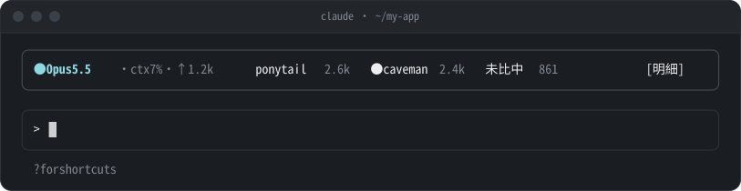
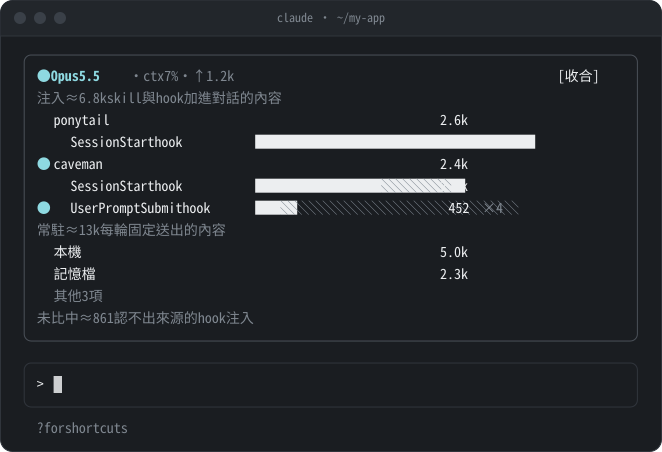

# session-lens

Claude Code mod：在輸入框上方顯示目前的模型、context 用量，以及這個 session 裡各 plugin 透過 skill 和 hook 注入了多少內容。終端機與 desktop app 都適用。

## 這個 mod 在算什麼

送給模型的 context 裡，有一部分是 plugin 加進來的。這個 mod 把這部分拆成兩類：

- **注入**：對話途中才加進來的內容，包括 skill 被叫用時展開的全文，以及 hook（例如 SessionStart、UserPromptSubmit）附加的文字。從 session 開始一路累加。
- **常駐**：每一輪都會跟著送出的固定內容，例如各 plugin 的 skill 清單、MCP 工具定義、subagent 定義、CLAUDE.md 等記憶檔。顯示的是最近一次查到的數字，不累加。

不只算 skill：hook 注入、MCP 工具和記憶檔也都算在內。另外，注入是 session 累計，對話壓縮（compact）後也不會扣掉，所以可能比 context 裡實際剩下的還多。context 目前用了多少，以 `ctx` 為準。

## 一行模式



由左到右依序是：

- `● Opus 5.5`：目前的模型。
- `ctx 7%`：context window 目前用掉的比例，涵蓋系統提示、工具定義、對話紀錄等所有內容，數字是 Claude Code 在本機估算的。
- `↑1.2k`：最近一輪主對話裡，模型總共輸出了多少 token。一輪是指從你送出訊息，到模型回覆完畢為止。這段時間裡每一次請求的輸出都會加總，包括思考、文字和工具呼叫的參數；subagent 的輸出不算。新的一輪開始時這個數字會先消失，回覆完畢後才再出現。
- `ponytail 2.6k` 這類項目：各 plugin 在這個 session 累計注入的量，由多到少排列。subagent 排在一般來源之後，未比中固定排在最後。名稱前有 `●` 的，表示這一輪有注入。

## 明細

按「明細」展開，分成注入、常駐兩段，最後列出未比中的合計：



- **注入**：skill 展開的內容，以及 hook 附加給模型的 context，依 plugin 分組。`×N` 是次數。
- **常駐**：每一輪都會送出的固定內容，例如各 plugin 的 skill 清單、已載入的 MCP 工具定義、subagent 定義、CLAUDE.md 等記憶檔。全螢幕模式下全部列出，超過這一區的高度時，用滑鼠滾輪或鍵盤捲動；一般模式下，明細最多佔半個視窗高，常駐放不下的併成「其他 N 項」。
- **未比中**：認不出是哪個 plugin 注入的 hook 內容，只列一個合計。Claude Code 不提供 hook 注入的來源，要細分就得寫比對規則。
- 送進 subagent 的 hook 注入另歸「subagent」一組，比中規則的依名稱分列，未比中的依事件名稱分列。即使有 plugin 也叫 subagent，兩組也不會合併。skill 分辨不出是在主對話還是 subagent 裡展開的，所以一律算在主對話。
- 不屬於任何 plugin 的 skill（個人、專案或內建的 skill）歸在「本機」。

### 常見的 hook 事件

注入依事件分列，因為不同事件的注入次數差很多：有的整個 session 只注入一次，有的每輪、甚至每次工具呼叫都會注入。同一個 plugin 的總量差不多時，每輪都注入的那種，對話越長越吃 context。

| 事件 | 何時注入 | 次數 |
| --- | --- | --- |
| [SessionStart](https://code.claude.com/docs/en/hooks#sessionstart) | session 開始或恢復時 | 每個 session 一次 |
| [UserPromptSubmit](https://code.claude.com/docs/en/hooks#userpromptsubmit) | 你送出訊息後、模型處理之前 | 每輪一次 |
| [PreToolUse](https://code.claude.com/docs/en/hooks#pretooluse) | 每次呼叫工具之前 | 每次工具呼叫 |
| [PostToolUse](https://code.claude.com/docs/en/hooks#posttooluse) | 工具執行成功之後 | 每次工具呼叫 |
| [SubagentStart](https://code.claude.com/docs/en/hooks#subagentstart) | 啟動 subagent 時，注入給該 subagent | 每個 subagent 一次 |
| [Stop](https://code.claude.com/docs/en/hooks#stop) | 模型回覆完畢時 | 每輪一次 |

其他會注入內容的事件，以及每段注入最多 10,000 字元的限制，請見官方文件的 [Add context for Claude](https://code.claude.com/docs/en/hooks#add-context-for-claude)。

## 認出 hook 是哪個 plugin 注入的

引擎不會告訴 mod 某段 hook 注入是哪個 plugin 的，所以要自己設定比對規則。執行 `/config`，找到「hook 比對規則」，一條寫一行，格式是「開頭文字=名稱」：

```
PONYTAIL MODE=ponytail
CAVEMAN MODE=caveman
<EXTREMELY_IMPORTANT>=superpowers
```

- 只比對注入內容的第一行。引擎加在前面的「SessionStart:startup hook success: 」這類前綴會先去掉。
- 比對完內容就丟掉，不保存也不顯示。
- 預設沒有任何規則，沒設定時所有 hook 注入都列在「未比中」。
- 更新 plugin 不會清掉規則，但**移除 plugin 時規則會一起刪除**，重裝後要重新填。
- 其他 plugin 改了注入內容的開頭，規則就會失準，要自己更新。

### 找出開頭文字

mod 算完 token 就把內容丟掉，所以畫面上看不到未比中的是什麼，要從下面兩個地方找。

**方法一：從對話紀錄找（建議先用這個）**

Claude Code 會把每個 session 的紀錄存成 `~/.claude/projects/<專案>/<session id>.jsonl`，裡面記有每段 hook 注入的內容。開一個已經用過一陣子的 session，在終端機執行下面的指令。它會讀最近更新的那份紀錄，每段 hook 注入只印一行：

```sh
python3 - "$(ls -t ~/.claude/projects/*/*.jsonl | head -1)" <<'EOF'
import json, sys

seen = set()
for line in open(sys.argv[1], encoding='utf-8'):
    try:
        a = json.loads(line).get('attachment') or {}
    except ValueError:
        continue
    if a.get('type') not in ('hook_success', 'hook_additional_context'):
        continue
    text = a.get('content') or ''
    if isinstance(text, list):
        text = '\n'.join(map(str, text))
    first = text.strip().split('\n', 1)[0][:80]
    if first and first not in seen:
        seen.add(first)
        print(f"{a.get('hookEvent')}\t{first}\t{a.get('command', '')}")
EOF
```

輸出分三欄，以 Tab 分隔：事件名稱、注入內容的第一行、hook 的指令或狀態訊息（可能是空的）。例如：

```
SessionStart	PONYTAIL MODE ACTIVE — level: full	Loading ponytail mode...
SessionStart	CAVEMAN MODE ACTIVE — mode: caveman	Loading caveman mode...
SessionStart	<EXTREMELY_IMPORTANT>
UserPromptSubmit	CAVEMAN MODE ACTIVE (caveman). Respond terse like smart caveman. All technical s
```

第二欄就是要拿來寫規則的開頭文字。第一欄和第三欄用來判斷是哪個 plugin：通常第二欄或第三欄就看得出來；看不出來時，用方法二對照。

- 指令只印出 hook 注入內容的第一行，不會印出你的對話內容。
- 這份紀錄的格式是 Claude Code 內部的，不保證不變。指令沒有輸出、或輸出看起來不對時，改用方法二。

**方法二：從 plugin 的 hook 設定找**

1. 打開 `~/.claude/plugins/installed_plugins.json`，每個 plugin 的 `installPath` 就是它的安裝位置。
2. hook 的定義在安裝位置底下的 `hooks/hooks.json`。如果 `.claude-plugin/plugin.json` 有 `hooks` 欄位，就以它為準：欄位的值是路徑時打開那個檔案，是物件時定義就寫在裡面。
3. 找出 `SessionStart`、`UserPromptSubmit` 這類事件底下 `type` 為 `command` 的指令，打開指令執行的腳本，看它輸出的第一行。`${CLAUDE_PLUGIN_ROOT}` 代表安裝位置。
4. 腳本可能改動那個 plugin 的狀態，所以只讀程式碼，不要直接執行。

### 挑開頭文字的原則

- **只取固定不變的部分。** 例如 `PONYTAIL MODE ACTIVE — level: full` 的 `full` 會隨設定改變，規則寫成 `PONYTAIL MODE=ponytail`。
- **一個 plugin 可以有好幾條規則。** 不同事件的第一行不一樣時，各寫一條，名稱填同一個，就會歸在同一組。上面的 caveman 兩行開頭剛好都是 `CAVEMAN MODE`，寫一條就夠了。
- **別太短。** 例如只寫 `<` 會把其他 plugin 的注入也算進來。規則依順序比對，第一條比中的就生效。
- **名稱用 plugin 的名字**，和 skill 那邊顯示的分組名稱一致，同一個 plugin 的 skill 和 hook 注入就會合在同一組。

### 交給 AI 代勞

可以把下面這段直接貼給 Claude Code，讓它代為產生規則：

```
請幫我產生 session-lens 的 hook 比對規則：
1. 依 session-lens README「找出開頭文字」的方法一，執行那段 python3 指令，列出 hook 注入的第一行。
2. 判斷每一行屬於哪個 plugin；判斷不出來時，依方法二讀該 plugin 的 hook 設定與腳本對照，只讀不執行。
3. 依「挑開頭文字的原則」，每個 plugin 寫出「開頭文字=plugin 名稱」，一條一行。
4. 只列出規則給我，不要修改任何設定檔；我會自己到 /config 的「hook 比對規則」貼上。
5. 對話紀錄裡只讀 hook 注入的那幾筆，不要讀取或引用其他對話內容。
```

## 其他說明

- 外框是灰色圓角細框，上下各多佔一行；框線與左右留白共佔 4 欄。
- 右上角的 `[-]` 是 Claude Code 本身的收合鈕，按下或按 `ctrl+x ctrl+a` 會收起整條。
- 一行放不下時，依上面的順序從前面開始顯示，其餘收成 `+N`。視窗窄到一個都放不下時，不顯示 `+N`。
- 視窗窄於 48 欄時，明細不畫長條，常駐只顯示加總；名稱會縮短，讓數字完整顯示。48 欄以上一定畫長條，空間不夠時先縮短名稱。
- 明細裡超過 32 格的名稱會截斷，結尾補「…」；80 欄的終端機放得下 32 格名稱加完整長條。段落標題後的說明放不下時同樣截斷。
- 畫面出現問卷時，整條暫時隱藏。
- 注入量是依文字估算的（中日韓字元約一字一 token，其他約四字元一 token），誤差約一到兩成。常駐成本用的是 Claude Code 在本機的估算，不會連網。
- 執行 `/reload-plugins` 後，session 開頭的 hook 注入會被重送一次，數字會多算一次。
- 模型在每一輪開始時更新；context 用量與常駐成本在每一輪結束時更新，第一輪結束前不會顯示。

## 資料範圍

- 統計只存在 session 記憶體中，不寫入硬碟、不連網。session 結束（離開、`/clear`、resume）時清空。
- mod 會看到每段送給模型的注入內容，但只處理 hook 輸出的那些；你用 `@` 提到的檔案、系統提醒等其他內容一律直接放行，不讀取也不計算。
- skill 和 hook 的內容只拿來估算 token，算完就丟，不保存、不顯示。
- 這個 mod 不讀取你送出的訊息。

## 安裝

在 Claude Code 的輸入框執行：

```
/plugin install session-lens --marketplace danielcheng80/session-lens
```

出現提示時輸入 `y` 新增 marketplace，再選擇安裝範圍。

Claude Code 依 `plugin.json` 的版本號判斷有沒有新版，版本號沒變就不會更新。

從 0.x 升到 1.0 時，統計的資料結構換了，升級後請開一個新的 session。

## 開發

```sh
claude plugin validate .
claude plugin test .
```

本機開發時，把這個資料夾登記成 marketplace 後安裝，修改檔案再執行 `/reload-plugins` 即可生效：

```sh
claude plugin marketplace add ~/projects/session-lens
claude plugin install session-lens@session-lens
```

介面改了之後，修改 `docs/images/render.py` 裡的示意內容，再執行 `python3 docs/images/render.py` 重新產生 README 的兩張圖。
